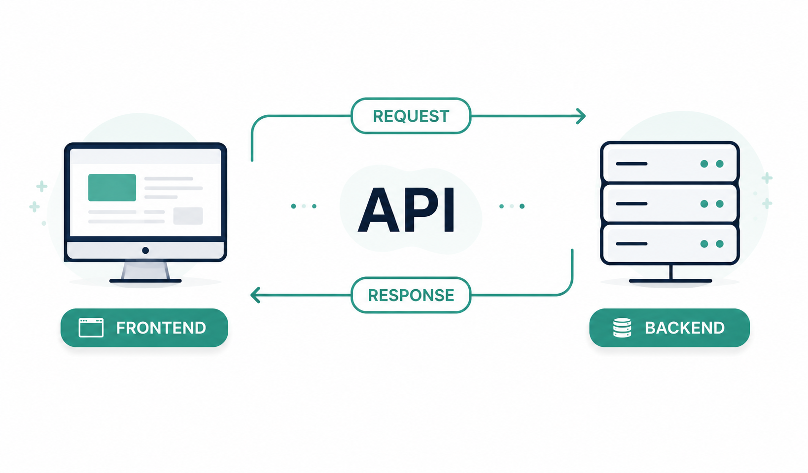
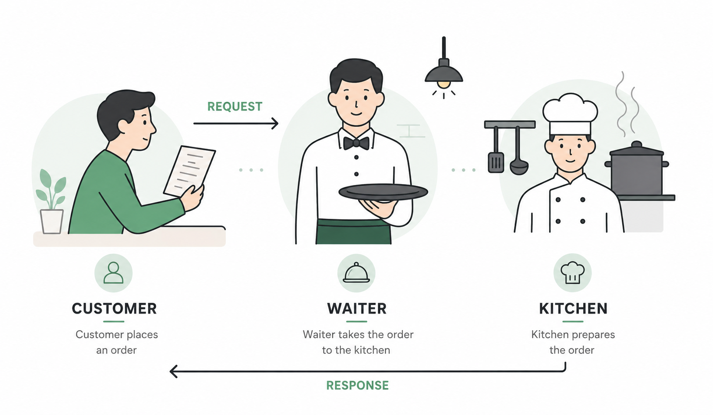
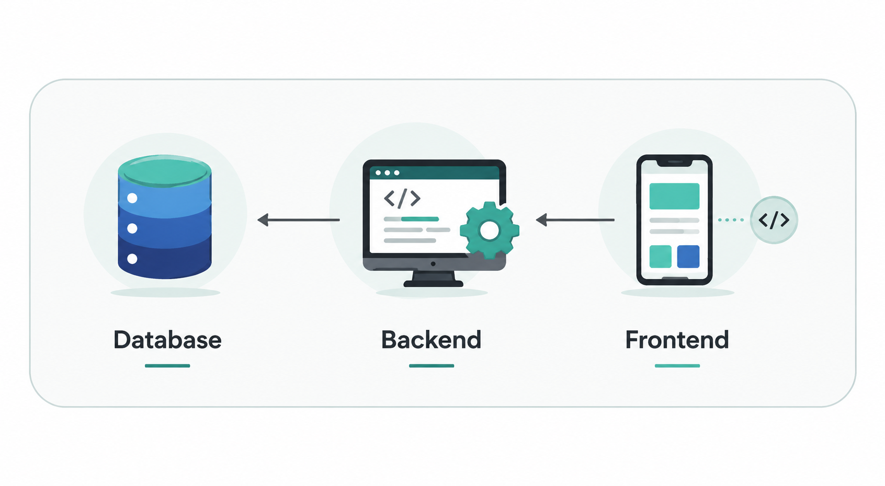
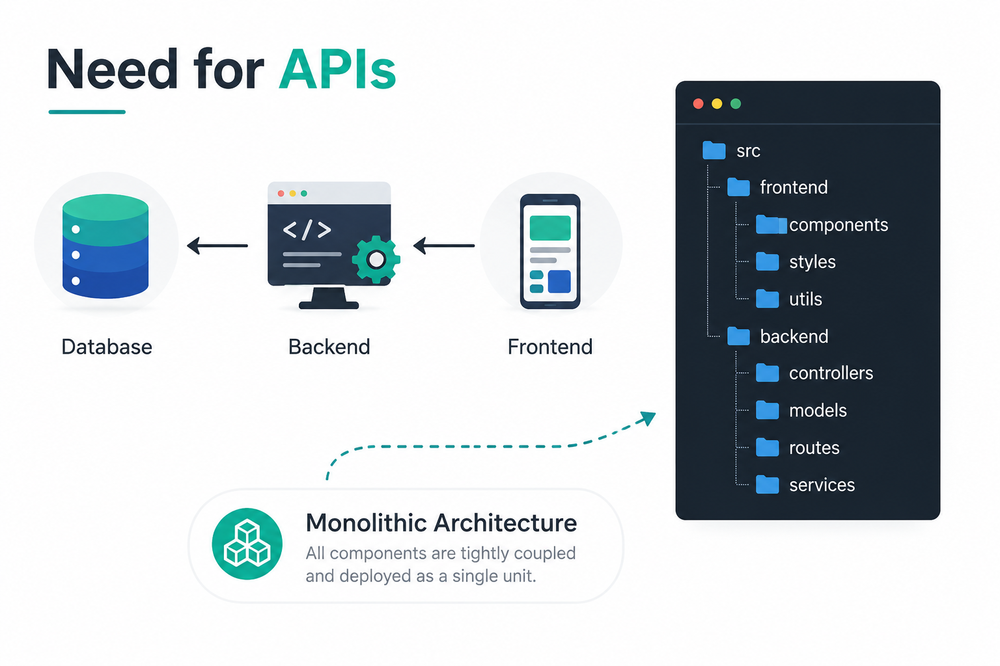
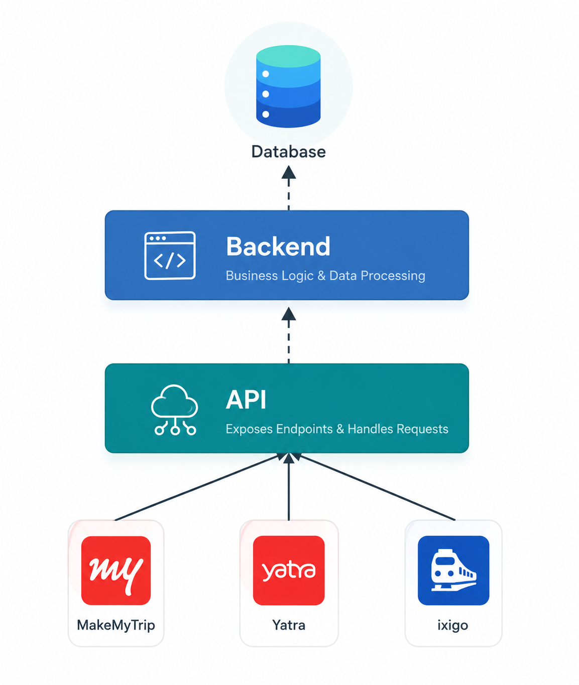
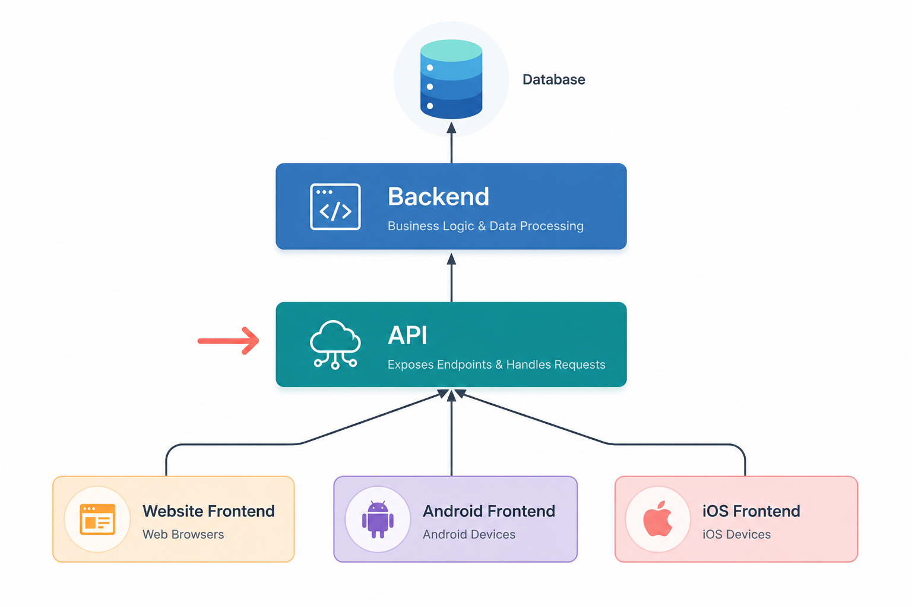
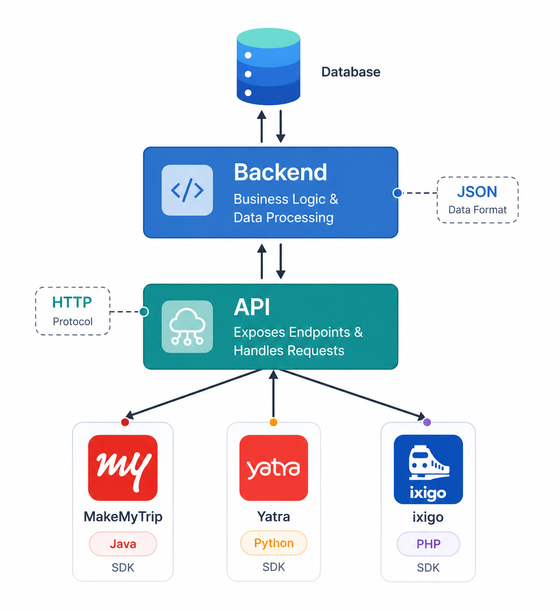
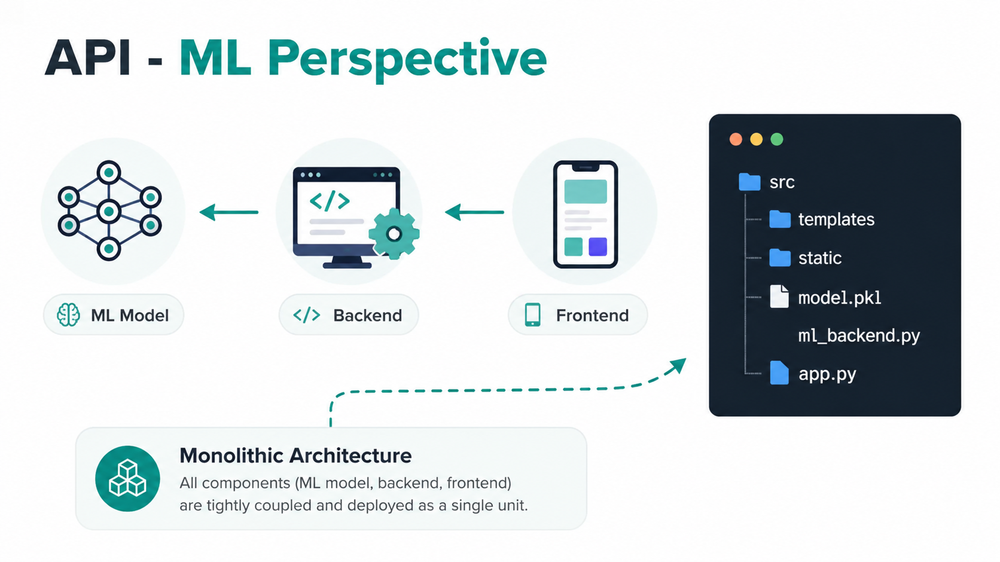
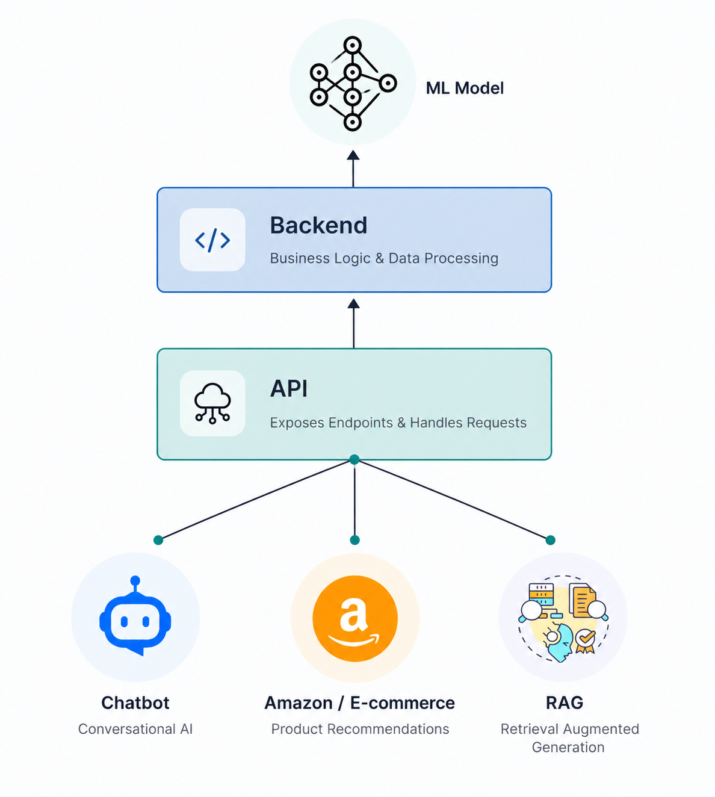
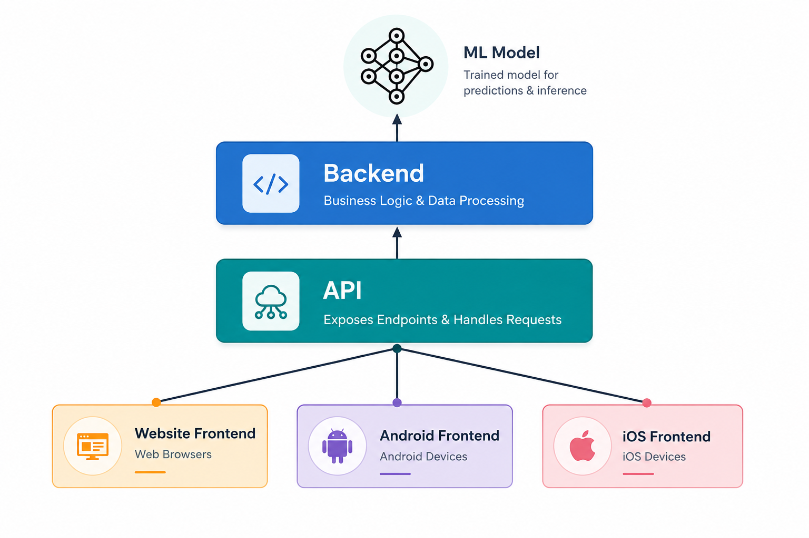

# What is an API? | Introduction to APIs | FAST API for Machine Learning

## What is an API?

- APIs are mechanisms that enable two software components - such as the frontend and backend of an application - to communicate with each other using a defined set of rules, protocols, and data formats.

## API Analogy

- This diagram explains APIs using a restaurant example.  
  The customer sends a request to the waiter, the waiter communicates with the kitchen, and the prepared response is returned back to the customer.

In the same way:

- Client → Sends Request
- API → Handles Communication
- Backend → Processes Logic
- Response → Returned to User
  

## Need for APIs

### Frontend and Backend Communication

This architecture shows how APIs connect frontend applications with backend services.

The frontend sends an HTTP request to the API, the backend processes the request, fetches data if required, and returns a JSON response back to the frontend.

### Why APIs are Important

Modern applications are divided into multiple layers such as frontend, backend, and database.  
APIs act as the communication bridge between these layers.

The frontend sends requests to the backend through APIs, and the backend interacts with the database before returning a response. This separation makes applications scalable, maintainable, and easier to develop.

### Application Architecture Overview

This diagram represents a basic application architecture.

- Database stores data
- Backend handles business logic
- Frontend displays data to users

The backend acts as the middle layer that connects the frontend with the database securely and efficiently.

### One API Serving Multiple Applications

A single backend API can serve multiple applications such as websites, Android apps, and iOS apps.

All frontend clients communicate with the same API endpoints, which helps maintain consistency and reduces duplicate business logic across platforms.

### Language Independent APIs

APIs are technology independent, which means applications built using different programming languages can communicate with the same backend service.

Here:

- Java application
- Python application
- PHP application

All consume the same API using HTTP requests and JSON responses.

## API - ML Perspective

### API Integration with Machine Learning

This architecture demonstrates how machine learning models can be integrated into backend systems using APIs.

The frontend sends data to the backend API, the backend communicates with the ML model, and predictions or results are returned back to the user.

### ML Powered Backend Architecture

In this setup, the backend handles application logic while the ML model performs predictions or intelligent processing.

The API exposes endpoints that allow frontend applications to interact with machine learning services in real time.

### Multi Platform API Architecture

This diagram shows how a single API can support different frontend platforms including websites, Android apps, and iOS applications.

Using a shared backend improves scalability, simplifies maintenance, and ensures consistent data flow across all platforms.

