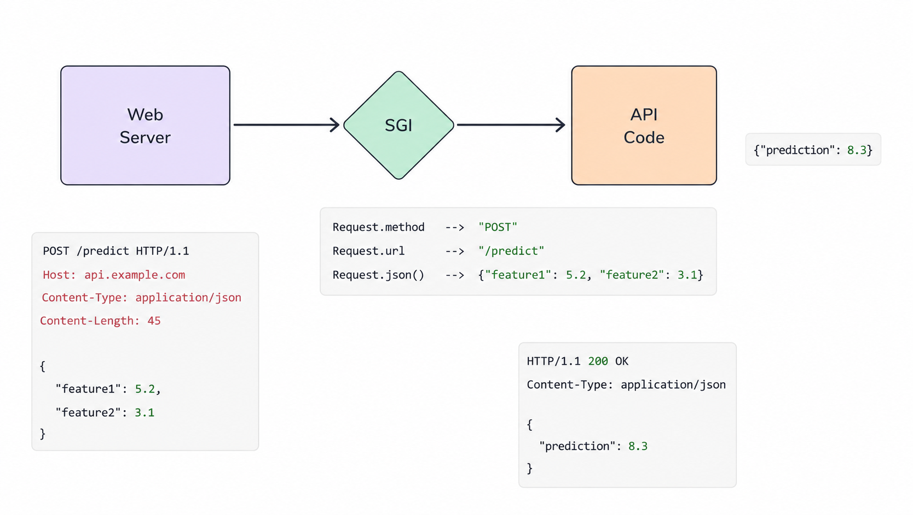

# FastAPI Philosophy | How to setup FastAPI | Installation and Code Demo

#### FastAPI is a modern, high-performance, web framework for building APIs quickly and efficiently with Python.


It is designed for:

- Fast development
- Clean code structure
- Automatic API documentation
- Async support
- High performance similar to Node.js and Go

FastAPI is widely used for:

- Backend development
- Machine Learning APIs
- AI applications
- Microservices
- Real-time applications

#### One of the best features of FastAPI is its simplicity and developer-friendly experience, making it a great choice for beginners as well as production-grade systems.

## Technical Architecture

- FastAPI is built upon two core libraries


### Starlette

- It manages how your API receives requests and sends back responses.
- Starlette is a lightweight ASGI framework/toolkit that provides the core building blocks for modern async web applications and APIs.

- FastAPI is built on top of Starlette, which is why FastAPI applications are fast, scalable, and support asynchronous programming.

#### Features

- Lightweight and minimal
- ASGI support
- Async request handling
- Routing and middleware support
- High performance backend foundation

### Pydantic

- It is used to check if the data coming into your API is correct and in the right format.
- Pydantic is a powerful Python library used for data validation and settings management using Python type hints.

- FastAPI uses Pydantic internally for request validation, response models, and automatic data parsing.

#### Features

- Automatic data validation
- Type-safe request handling
- JSON serialization
- Clean schema generation
- Easy integration with FastAPI

## Philosophy of FastAPI

- FastAPI is built on two primary pillars: Performance and Development Speed.


### Fast to Run

- Unlike older, synchronous frameworks like Flask (which use WSGI), FastAPI utilizes ASGI (Asynchronous Server Gateway Interface) and the Uvicorn server to handle concurrent requests efficiently.
- It also supports async/await syntax, allowing the application to process other tasks while waiting for I/O operations (like model predictions), which significantly reduces latency.

### Fast to Code

- The framework is designed for developer productivity.
- It leverages Pydantic for automatic, type-hinted data validation and includes built-in, interactive API documentation (Swagger UI) that updates automatically as you define your endpoints.

## Why FastAPI is Fast to Run?

### Web Server → SGI → API Flow



This flowchart explains how a request moves through a Python web application architecture.

1. The client sends an HTTP request to the web server.
2. The SGI layer acts as the communication bridge between the server and application code.
3. The API processes the request logic.
4. A JSON response is returned back to the client.

This architecture helps separate:

- Request handling
- Application logic
- Response generation

It is commonly used in backend systems, ML APIs, and modern web applications.

### Flask vs FastAPI Architecture

This comparison highlights the difference between traditional synchronous frameworks like Flask and asynchronous frameworks like FastAPI.


#### Flask (WSGI)

- Uses synchronous request handling
- Processes one request at a time per worker
- Built on WSGI and Werkzeug
- Commonly served using Gunicorn

#### FastAPI (ASGI)

- Supports asynchronous programming
- Handles multiple requests efficiently
- Built on ASGI and Starlette
- Commonly served using Uvicorn

FastAPI provides better performance and scalability for modern APIs, especially in real-time systems, AI applications, and high-concurrency backend services.

## Why FastAPI is Fast to Code?

- Automatic Input Validation.
- Auto-Generated Interactive Documentation.
- Seamless Integration with Modern Ecosystem (ML/DL Libraries, OAuth, JWT, SQL Alchemy, Docker, Kubernetes etc.)

## Code Demo: Understanding `main.py`

Let's look at a basic FastAPI application. Here is the code from `main.py`:

```python
from fastapi import FastAPI

app = FastAPI()

@app.get("/")
def hello():
    return {"message": "Hello World"}

@app.get("/about")
def about():
    return {"message":  "About FastAPI"}
```

### Deep Explanation of the Code

- **`from fastapi import FastAPI`**: This imports the `FastAPI` class from the `fastapi` module, which provides all the functionality needed to build the API.
- **`app = FastAPI()`**: This creates an instance of the `FastAPI` class. This `app` instance is the main point of interaction to create the API. It is also what the ASGI server (like Uvicorn) uses to serve the application.
- **`@app.get("/")`**: This is a path operation decorator. 
  - `@` tells Python this is a decorator.
  - `app` refers to the FastAPI instance created earlier.
  - `get` refers to the HTTP GET method (used to read data).
  - `"/"` is the path or route. In this case, it's the root URL.
- **`def hello():`**: This is the path operation function. It gets called whenever a GET request is made to the `"/"` URL.
- **`return {"message": "Hello World"}`**: The function returns a Python dictionary. FastAPI automatically converts this dictionary into JSON format and sends it back to the client as an HTTP response. The same logic applies to the `/about` endpoint.

## How to Run the FastAPI Application

To run the FastAPI application, you need an ASGI server. The recommended server is **Uvicorn**.

### 1. Install Dependencies
If you haven't installed FastAPI and Uvicorn yet, open your terminal and run:
```bash
pip install fastapi "uvicorn[standard]"
```

### 2. Run the Server
Navigate to the directory containing your `main.py` file and execute the following command:
```bash
uvicorn main:app --reload
```

**Understanding the command:**
- `uvicorn`: Starts the Uvicorn server.
- `main`: Refers to the file `main.py` (the Python module).
- `app`: Refers to the `FastAPI` instance created inside `main.py` (`app = FastAPI()`).
- `--reload`: Automatically restarts the server whenever you make code changes. This is highly recommended for development.

### 3. Access the API
Once the server is running, you can access your API in a web browser:
- Root Endpoint: http://127.0.0.1:8000/
- About Endpoint: http://127.0.0.1:8000/about

**Automatic Documentation:**
FastAPI automatically generates interactive API documentation. You can access it at:
- Swagger UI: http://127.0.0.1:8000/docs
- ReDoc: http://127.0.0.1:8000/redoc
