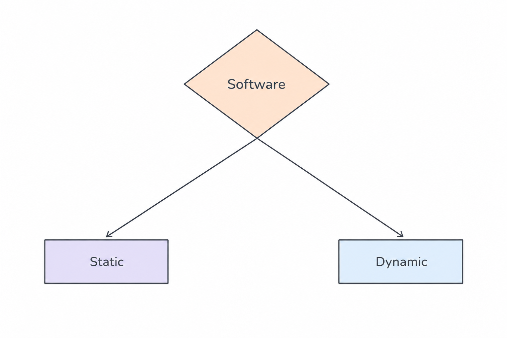
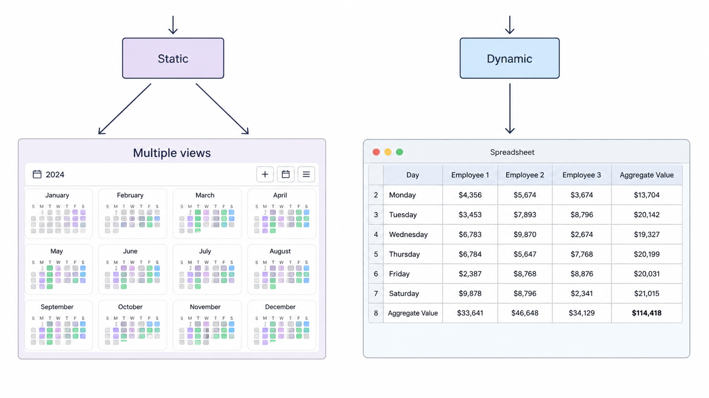
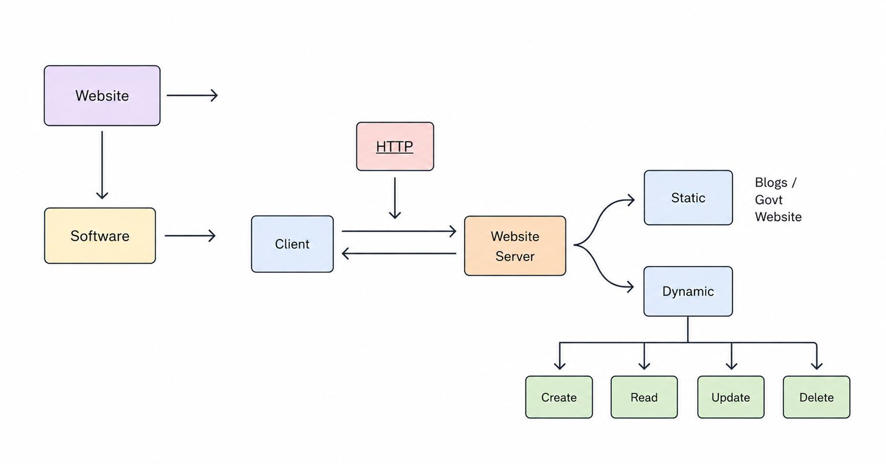
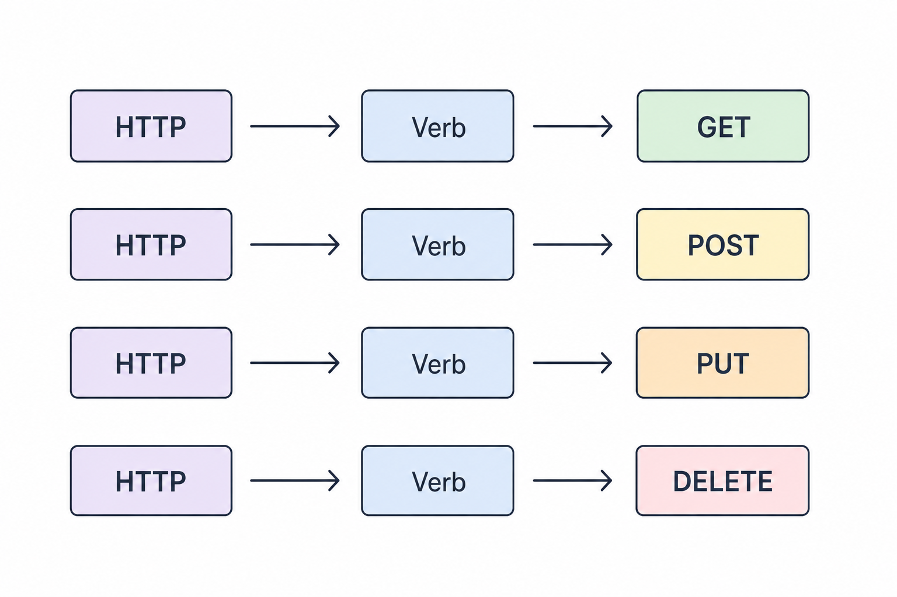
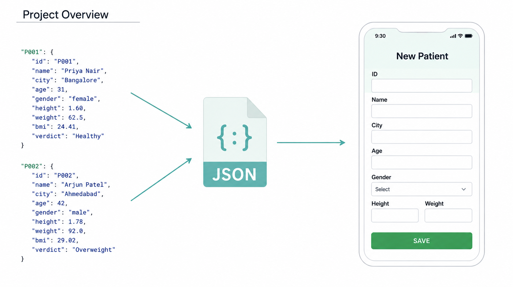

# HTTP Methods in FastAPI

## Static vs Dynamic Websites

Software applications can generally be divided into two categories:

- Static Websites
- Dynamic Websites



### Static Websites

Static websites display fixed content and usually do not change frequently.

Examples:
- Blogs
- Portfolio websites
- Government websites
- Documentation pages

### Dynamic Websites

Dynamic websites generate content dynamically based on user interactions and database operations.

Dynamic applications commonly perform CRUD operations:

- Create
- Read
- Update
- Delete

Examples:
- Social media platforms
- E-commerce websites
- Banking applications
- Dashboard systems



## Client and Server Communication

This architecture demonstrates how clients communicate with servers using the HTTP protocol.

### Flow

1. Client sends an HTTP request
2. Server processes the request
3. Server returns a response back to the client

The website server can serve:
- Static content
- Dynamic content

Dynamic systems usually interact with databases and business logic to perform operations like creating, updating, reading, or deleting data.



## HTTP Methods (HTTP Verbs)

HTTP methods define the type of operation performed on a resource.

### GET

Used to retrieve data from the server.

Example:
- Fetch user details
- Read blog posts

---

### POST

Used to send new data to the server.

Example:
- Create a new user
- Submit a form

---

### PUT

Used to update existing data.

Example:
- Update profile information
- Edit product details

---

### DELETE

Used to remove data from the server.

Example:
- Delete a user
- Remove a post



## CRUD Operations in APIs

Most backend applications revolve around CRUD operations.

| Operation | HTTP Method | Description |
|-----------|-------------|-------------|
| Create | POST | Add new data |
| Read | GET | Retrieve data |
| Update | PUT | Modify existing data |
| Delete | DELETE | Remove data |

CRUD operations are the foundation of modern APIs and database-driven applications.

## JSON Data Flow in Applications

- How JSON data is used in modern applications to transfer information between systems and user interfaces.

### Project Overview

1. Patient data is stored in JSON format.
2. The JSON object acts as a structured data container.
3. The application reads the JSON data.
4. The frontend form displays or processes the received information.



---

### Why JSON is Important

JSON (JavaScript Object Notation) is one of the most commonly used data formats in APIs and backend systems because it is:

- Lightweight
- Human readable
- Easy to parse
- Language independent
- Widely supported across platforms

---

### Real World Usage

JSON is commonly used in:
- REST APIs
- Mobile applications
- Frontend-backend communication
- Database responses
- Machine Learning APIs
- Healthcare and patient management systems

---

### Example JSON Structure

```json
{
    "id": "P001",
    "name": "Priya Nair",
    "city": "Bangalore",
    "age": 31,
    "gender": "female",
    "height":1.60,
    "weight": 62.5,
    "bmi": 24.41,
    "verdict": "Healthy"
}

{
    "id": "P002",
    "name": "Arjun Patel",
    "city": "Ahmedabad",
    "age": 42,
    "gender": "male",
    "height":1.78,
    "weight": 92,
    "bmi": 29.02,
    "verdict": "Overweight"
}

