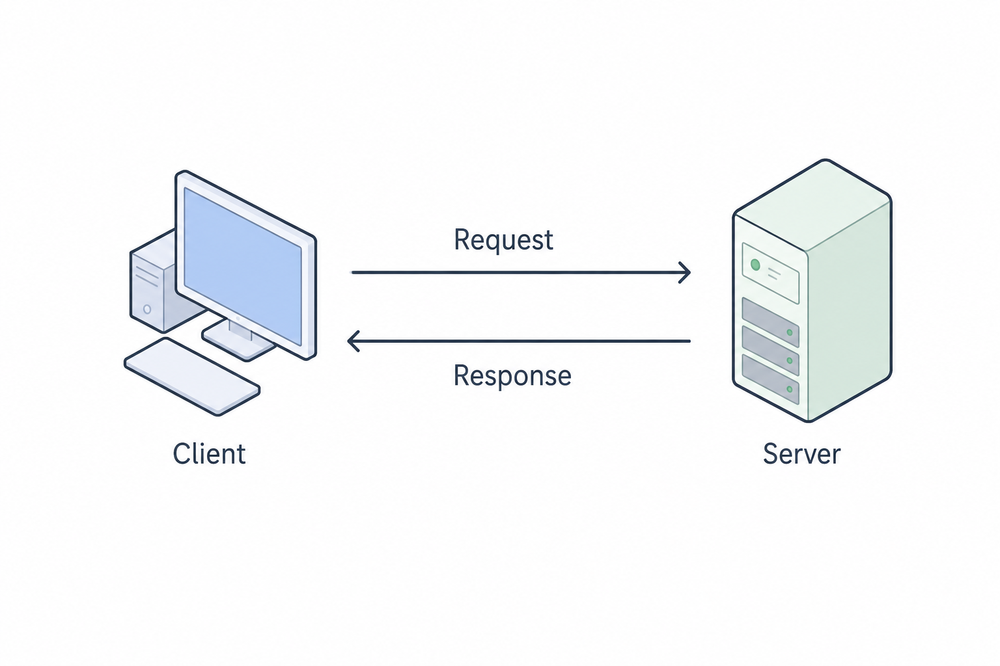
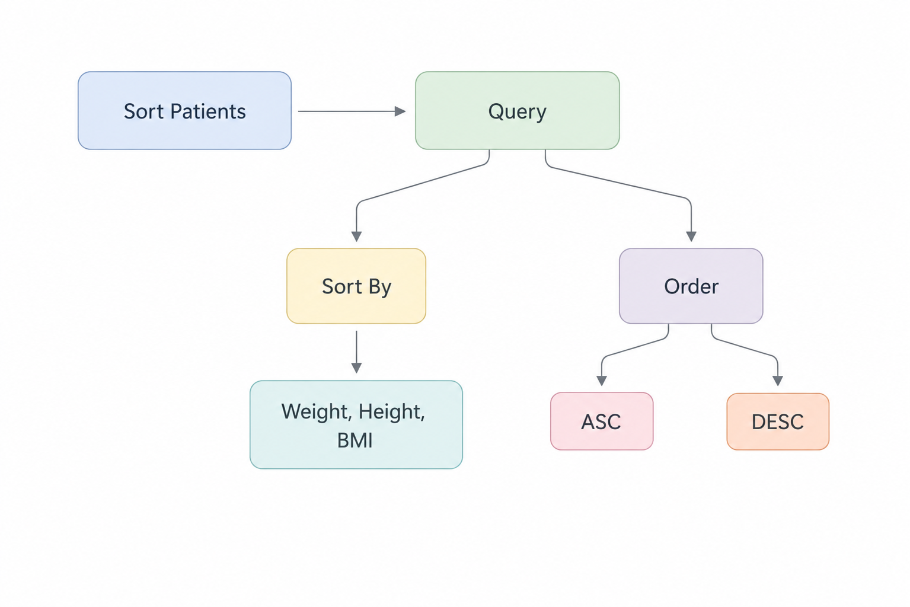

# Path & Query Params in FastAPI

## Path Parameters

- Path Parameters are dynamic segements of a URL path used to identify a specific resource.

### Path() Function

- The Path function in FastAPI is used to provide metadata, validation rules, and documentation hints for path parameters in your API endpoints.
  - Title
  - Description
  - Example
  - ge, gt, le, lt
  - Min_length
  - Max_length
  - Regex

### HTTPS Status Codes

- These are 3-digit numbers returned by a web server (like FastAPI) to indicate the result of a client's request (like from a browser or API consumer).

- They help the **client(browser, frontend, mobile app, etc.)** understand:
  - whether the request was successful.
  - whether something went wrong.
  - and what kind of issue occurred (if any).

### HTTP Status Code Categories

| Status Code | Category        | Description                                         |
| ----------- | --------------- | --------------------------------------------------- |
| 2xx         | ✅ Success      | The request was successfully received and processed |
| 3xx         | 🔄 Redirection  | Further action needs to be taken (e.g. redirect)    |
| 4xx         | ⚠️ Client Error | Something is wrong with the request from the client |
| 5xx         | ❌ Server Error | Something went wrong on the server side             |

### Common HTTP Status Codes

| Status Code               | Meaning                 | Description                               | Example                          |
| ------------------------- | ----------------------- | ----------------------------------------- | -------------------------------- |
| 200 OK                    | Standard Success        | Request completed successfully            | A GET or POST request succeeded  |
| 201 Created               | Resource Created        | New resource was created successfully     | After a POST request             |
| 204 No Content            | Success Without Data    | Request succeeded but no content returned | After a DELETE request           |
| 400 Bad Request           | Invalid Request         | Malformed or incorrect request data       | Missing field or wrong data type |
| 401 Unauthorized          | Authentication Required | User is not authenticated                 | Login required                   |
| 403 Forbidden             | Access Denied           | User authenticated but lacks permission   | Logged in but not allowed        |
| 404 Not Found             | Resource Missing        | Requested resource does not exist         | Patient ID not found in database |
| 500 Internal Server Error | Server Failure          | Generic server-side error                 | Something broke on the server    |
| 502 Bad Gateway           | Gateway Error           | Server failed to communicate with backend | Nginx could not reach backend    |
| 503 Service Unavailable   | Service Down            | Server overloaded or unavailable          | Backend service temporarily down |

### HTTPException

- **HTTPException** is a special built-in exception in FastAPI used to **return custom HTTP error responses** when something goes wrong in API.
- Instead of returning a normal JSON or crashing the server, we can gracefully raise an error with:
  - a proper HTTP status code (like 400, 403, 404, etc.)
  - a custom error message
  - (optional) extra headers

## Query Parameter

- **Query parameters** are optional key-value pairs appended to the end of a URL, used to **pass additional data** to the server in an HTTP request.
- They are typically employed for operations like filtering, sorting, searching and pagination, without altering the endpoint path itself.

**Example**

- _/patients?city=Delhi&sort_by=age_

- The **?** marks the start of the query parameters.
- Each parameter is a key-value pair: **key=value**
- Multiple parameter are separated by **&**

In this case:

- **city=Delhi** is a query parameter for filtering
- **sort_by=age** is another query parameter for sorting

### Query() Function

- This is a utility function provided by **FastAPI** to declare, validate and document **query parameters** in API endpoints.
- It allow us to:
  - Set **default values**
  - Enforce **validation rules**
  - Add **metadata** like description, title, examples

