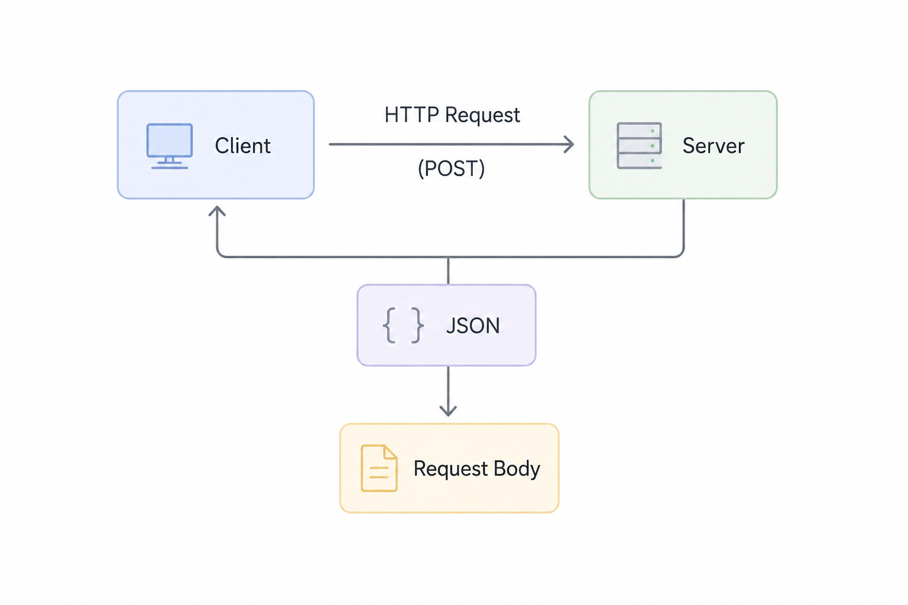

# Post Request in FastAPI | What is Request Body?

## Project Progress

## What is Request Body?
- A **request body** is the portion of an HTTP request that contains data sent by the client to the server.
- It is typically used in HTTP methods such as **POST** or **PUT** to transmit structured data (e.g., JSON, XML, form-data) for the purpose of creating or updating a resource on the server.
- The server parses the request body to extract the necessary information and perform the intended operation.

