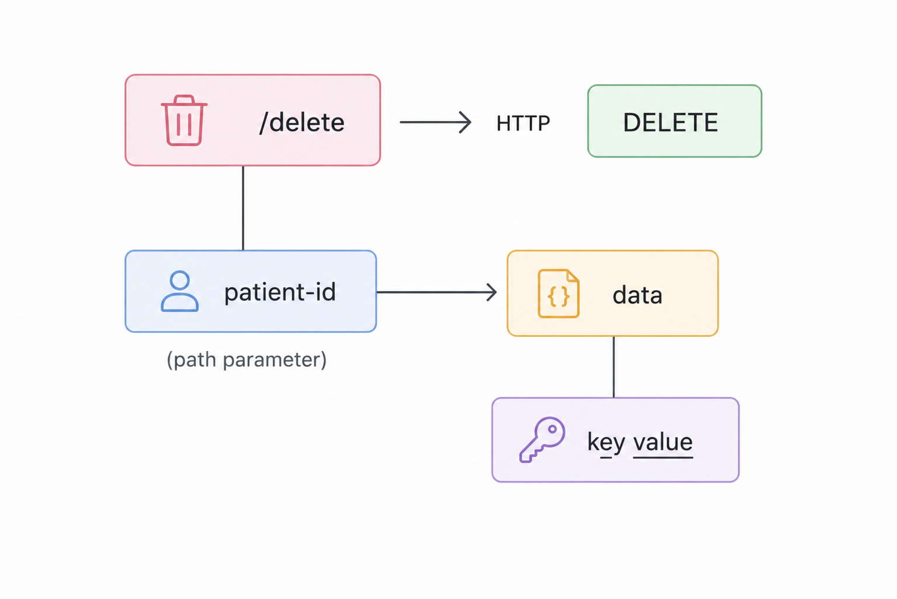
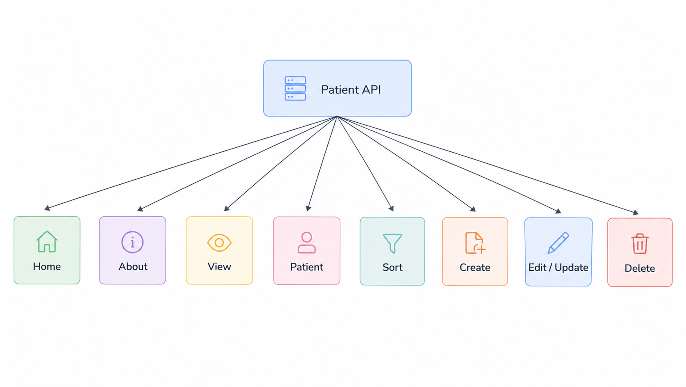

# PUT & DELETE in FastAPI

## Project Progress

## Update Endpoint (PUT HTTP Method)

- The PUT method is used to update or modify existing records.

## Delete Endpoint (DELETE HTTP Method)

- The DELETE method is used to remove or delete existing records.

## Final Project Progress

