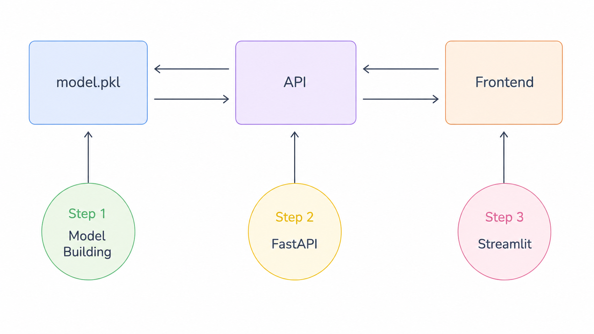

# Serving ML Models with FastAPI

## Flow Diagram

## Step 1: Building & Exporting the Model
- The process of building an ****Insurance Premium Prediction** model using a ****Random Forest Classifier**. - - This step covers feature engineering (creating variables like BMI, Age Group, Lifestyle Risk, and City Tier) and shows how to export the final trained model as a **.pkl** (pickle) file.

## Step 2: Building the API Endpoint
- This step covers how to wrap the ML model in a FastAPI application.
- Uses **POST** method for inference.
- Implements Pydantic models for data validation and metadata.
- Utilizes computed fields to dynamically generate model features from raw user input.
- Shows how to load the saved .pkl file and perform real-time predictions.

## Step 3: Testing the API
- Testing and Front-end Integration
- This step concludes by demonstrating how to consume the API using a Streamlit web interface, allowing users to input data and receive instant premium category predictions (High, Medium, or Low).