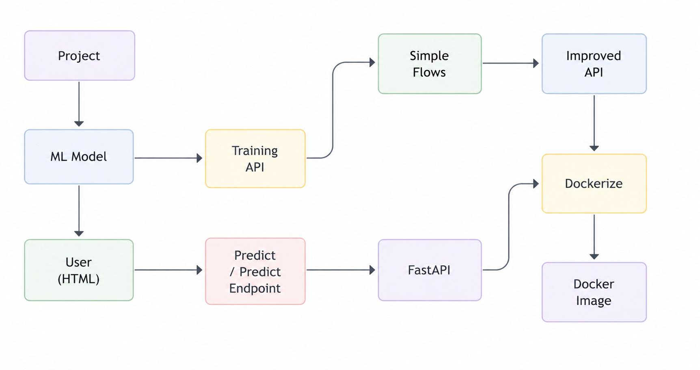

# How to Dockerize a FastAPI API Application

## Steps to create a Docker Image

- **Setup**
  - Install Docker
  - Create account on Docker Hub

- **Step 1**. Create a Dockerfile
- **Step 2**. Build the docker image [docker build -t your-docker-username/your-docker-reponame .]
- **Step 3**. Login to Docker Hub [docker login]
- **Step 4**. Push the image to Docker Hub [docker push your-docker-username/your-docker-reponame]
- **Step 5**. Pull the docker image
- **Step 6**. Run the docker image locally [docker run -d -p 8000:8000 your-docker-username/your-docker-reponame]

## Project Workflow

- This workflow demonstrates **From Prediction Endpoint to Dockerized FastAPI** by converting an ML model into a production-ready API.
- User input is sent to the **Prediction Endpoint**, processed through **FastAPI**, transformed into an **Improved API architecture**, and finally packaged as a **Docker Image** for easy deployment.
- This approach enables **ML Model Serving with FastAPI and Docker**, making machine learning applications scalable, portable, and accessible through web requests.
- **Complete Flow**: ML Model → FastAPI → Docker Image → Docker Container

